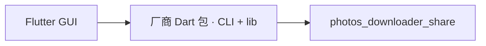

Photos Downloader 分成三层公开仓库。第一期文档站已上线；CLI/GUI 安装包仍在准备中。

| 层 | 组件 | 角色 |
| --- | --- | --- |
| GUI | [`photos_downloader_gui`](https://github.com/photos-downloader/photos_downloader_gui) | Flutter 应用，选择厂商并显示进度 |
| 厂商 + 共享 | [`photos_downloader_core`](https://github.com/photos-downloader/photos_downloader_core) Melos monorepo | `photos_downloader_share` 与各厂商 Dart library/CLI |
| 文档 | 本仓库 `photos_downloader` | 用户指南与状态说明 |

厂商实现统一实现 `CloudDownloader` 接口；GUI 通过 path/git 依赖直接调用 Dart 包，不再使用 Rust FFI。

公开讨论与文档 PR 请走 [photos-downloader/photos_downloader](https://github.com/photos-downloader/photos_downloader)。
