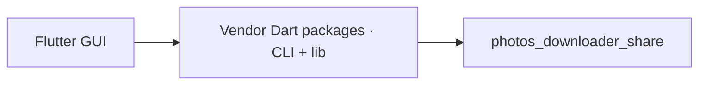

Photos Downloader has three public repositories. This first public release ships the website; CLI/GUI installers are still in progress.

| Layer | Component | Role |
| --- | --- | --- |
| GUI | [`photos_downloader_gui`](https://github.com/photos-downloader/photos_downloader_gui) | Flutter app: pick a vendor and show progress |
| Vendors + shared | [`photos_downloader_core`](https://github.com/photos-downloader/photos_downloader_core) Melos monorepo | `photos_downloader_share` plus per-vendor Dart libraries/CLIs |
| Docs | this `photos_downloader` repo | User guides and status |

Every vendor implements the `CloudDownloader` interface. The GUI calls Dart packages directly (path or git dependencies); there is no Rust FFI bridge.

Public discussion and documentation PRs go to [photos-downloader/photos_downloader](https://github.com/photos-downloader/photos_downloader).
